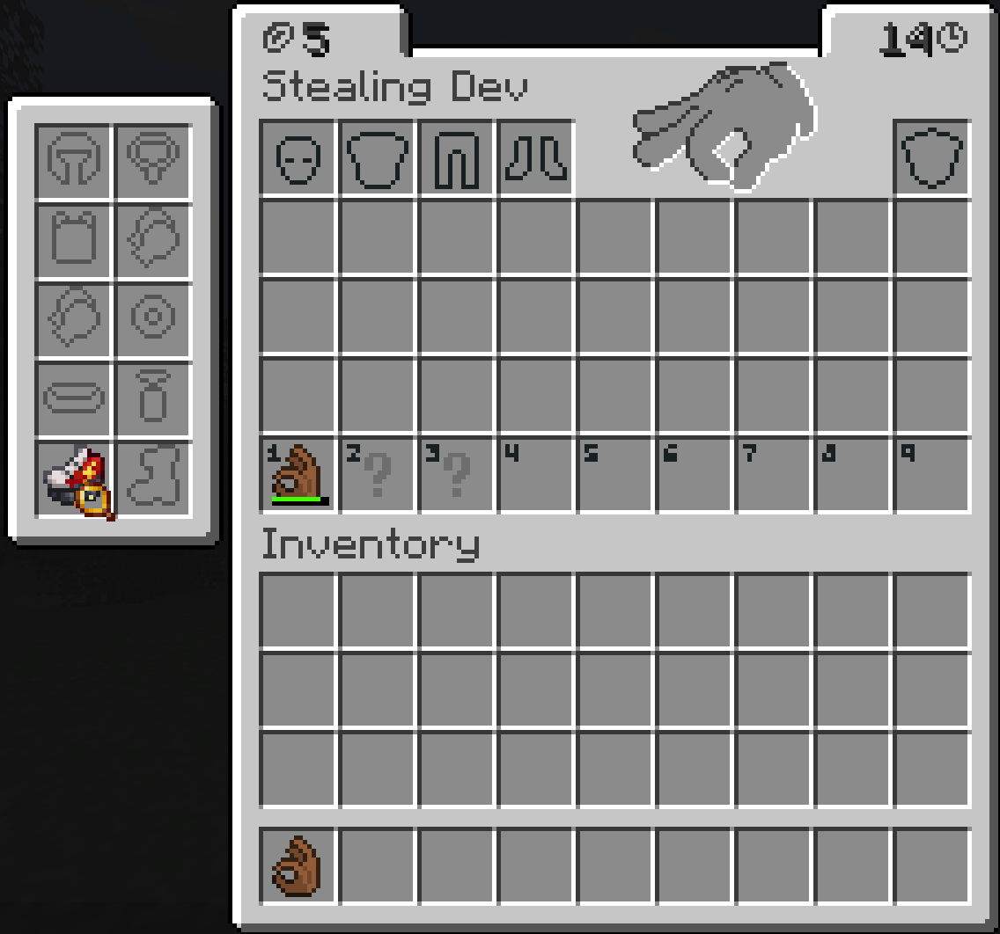

<p align="center">
  
</p>

<h1 align="center">Theft Mod</h1>

<p align="center">
  
</p>

<p align="center">
  <a href="https://www.curseforge.com/minecraft/mc-mods/theft-mod"></a>
  <a href="https://modrinth.com/mod/theft"></a>
  
  
</p>

> Available for **Fabric** and **NeoForge** on Minecraft **1.21.1**.

### What is Theft Mod?

Steal from other players by sneaking up behind them and using the Thief's Glove. Take their items as quickly as possible before they notice. Theft is fully customizable.

### Curios support

Theft can also show and steal items from a player's Curios slots. Curios is an **optional NeoForge integration**; Theft still works without it. Install Curios **9.2.0 or newer** and configure `steal_curios_items` to control Curios item stealing.

<p align="center">
  
</p>

### Screenshots

**Stealing**

<p align="center">
	
</p>

**Victim's inventory**

<p align="center">
	
</p>

### O que é Theft Mod? (Mod de Roubo)

Roube outros jogadores: aproxime-se por trás, agache-se e use a Luva do Ladrão. Roube o mais rápido possível antes que percebam. Mod totalmente personalizável.

<p align="center">
  
</p>

### Suporte ao Curios

No NeoForge, Theft também pode exibir e roubar itens dos espaços Curios de outro jogador. Curios é uma integração **opcional**; o mod funciona sem ele. Instale Curios **9.2.0 ou mais recente** e use `steal_curios_items` na configuração para controlar o roubo de itens Curios.

### Créditos

Mod feito por **Rokzin e Lucasmellof**.

### Build from source

Requires Java 21. Build both loader jars with:

```powershell
.\gradlew.bat :fabric:build :neoforge:build
```
